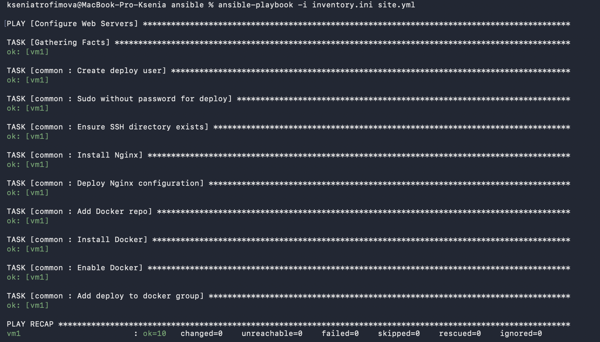
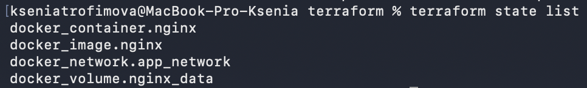
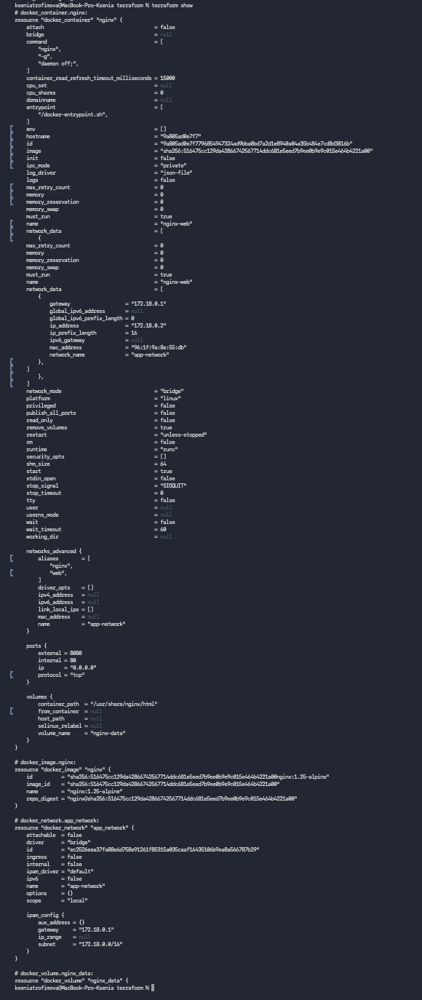
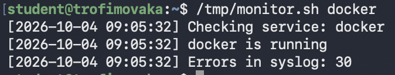
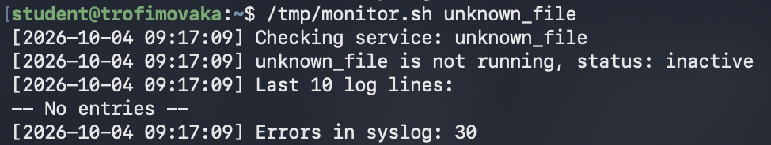
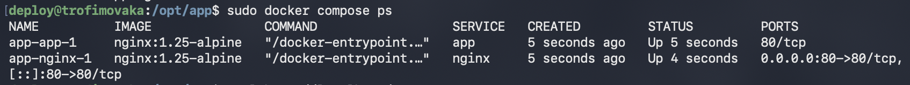
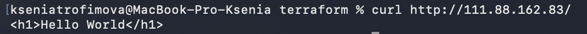

# devops_tasks hw1

## Структура репозитория

```
devops_tasks/
├── ansible/
│   ├── inventory.ini
│   ├── site.yml
│   └── roles/common/
│       ├── tasks/main.yml
│       ├── handlers/main.yml
│       └── templates/nginx.conf.j2
├── terraform/
│   └── main.tf
├── scripts/
│   └── monitor.sh
├── compose/
│   ├── docker-compose.yml
│   ├── nginx.conf
│   └── html/index.html
└── README.md
```

## Порядок развёртывания

### 1) Настройка конфигурации хоста

```bash
cd ansible
ansible-playbook -i inventory.ini site.yml
```

**Необходимо:** ssh-доступ по ключу к VM `111.88.162.83`

### 2) Создание контейнера nginx в отдельной сети с томом на порту 8080

```bash
cd terraform
terraform init
terraform plan
terraform apply -auto-approve
```

**Проверка:**
 
```bash
curl -i http://111.88.162.83:8080
```

Ожидается: `HTTP/1.1 200 OK`

**Возможная проблема:**

```
Error: Invalid provider registry host
The host "registry.terraform.io" ... does not offer a Terraform provider registry.
```

**Причина:** блокировка доступа к `registry.terraform.io` (ограничение по региону)

**Решение:** включить VPN

### 3) Скрипт мониторинга

```bash
scp -i ~/.ssh/id_ed25519 scripts/monitor.sh student@111.88.162.83:/tmp/
ssh -i ~/.ssh/id_ed25519 student@111.88.162.83 "sudo bash /tmp/monitor.sh docker"
```

### 4) Docker compose

На VM:

```bash
sudo mkdir -p /opt/app/html
sudo chown -R deploy:deploy /opt/app

# Скопировать compose/, либо создать файлы на VM вручную
cd /opt/app
sudo docker compose up -d
sudo docker compose ps
curl http://localhost/           # <h1>Hello World</h1>
```

## Скриншоты по этапам выполнения

- Второй запуск плэйбука (идемпотентность)


- terraform state list


- terraform show


- Результат работы скрипта


- Проверка скрипта на неизвестном сервисе


- docker-compose ps


- curl http://<IP>



